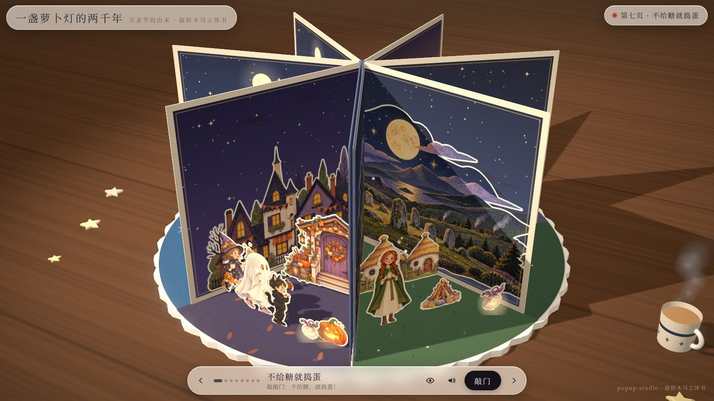
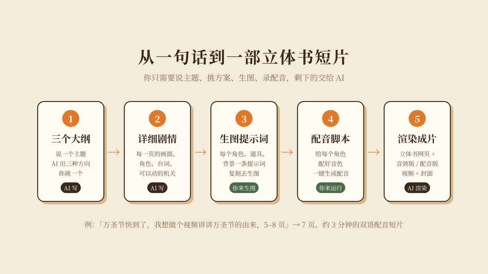
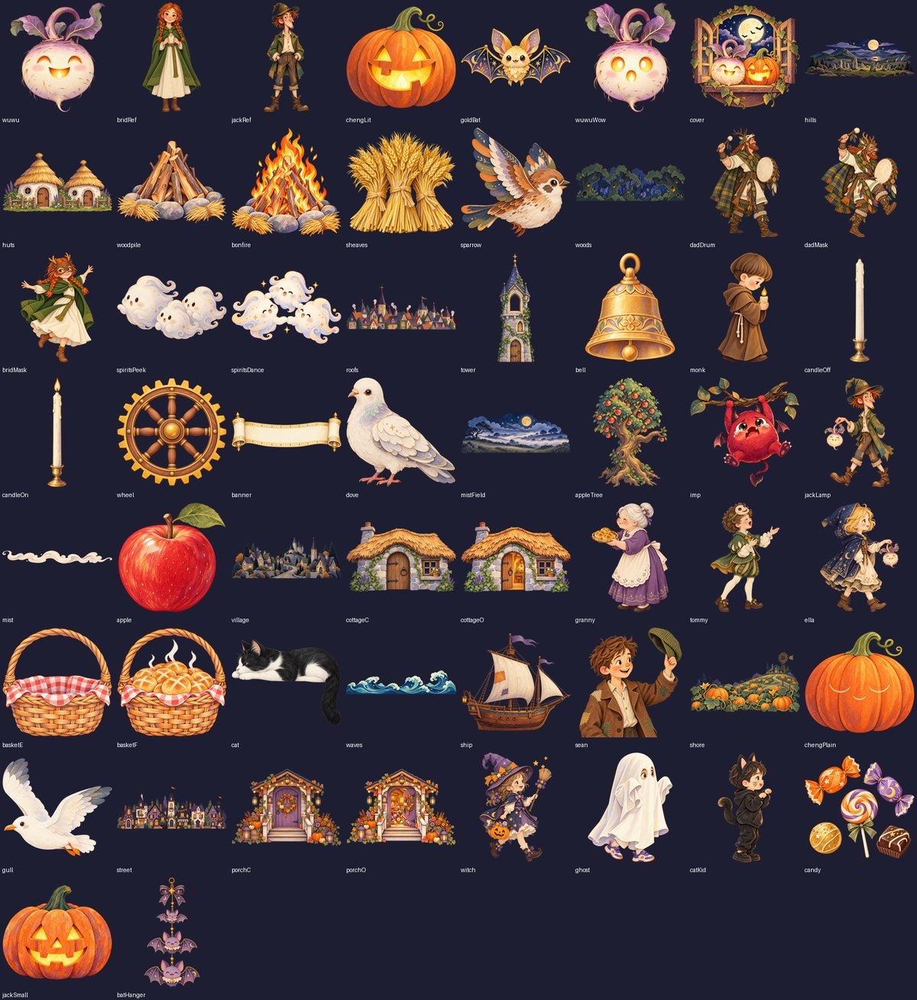

# DA Popup Studio · 一句话做一本会动的纸艺立体书


`da-popup-studio` 把一个主题变成可交互的纸艺立体书网页，以及带角色配音的立体书短片。从大纲、剧情、素材提示词到配音、时间线与视频合成，由 Claude Skill 分阶段协助完成。


> 示例：《一盏萝卜灯的两千年》，讲述万圣节的由来，包含 7 页故事与 35 句中英双语配音，成片约 3 分钟。

## 亮点

- **从主题开始**：先给出三个故事方向，再细化每页画面、角色、台词和机关。
- **两种立体书形式**：传统翻页纸雕与旋转木马小剧场，共用渲染和合成工具。
- **网页可以玩**：翻页、拉纸舌、转转盘、点击角色；具体交互随所选引擎和故事配置变化。
- **视频可以再剪**：输出音效版与配音版，支持中英双语字幕、横竖版封面和音轨素材。
- **素材可控**：按元素提供生图提示词，用户自行生成图片和配音，再导入搭书。
- **先看再渲染**：确认剧情与风格后制作，先检查六帧预览，正式渲染支持断点续跑。

## 安装到 Claude Code

需要 Git、Python 3.9+、npm 和 FFmpeg。仓库名称是 `da-popup-studio`，Skill 内部名称保留为 `popup-studio`。

```bash
git clone https://github.com/daaihq/da-popup-studio.git "$HOME/.claude/skills/popup-studio"
cd "$HOME/.claude/skills/popup-studio"
python3 -m pip install -r requirements.txt
python3 -m playwright install chromium
```

如果目录已经存在，进入目录执行 `git pull --ff-only`，先保留自己的未提交修改。

Claude.ai / Claude 桌面版可按其 Skills 上传入口要求打包此目录。实际渲染需要能够运行 Python、Chromium、FFmpeg 与 npm 的环境；仅上传 Skill 不会自动补齐运行环境。

## 快速开始

在 Claude 中直接说：

```text
使用 popup-studio，帮我做一本关于“种子如何长成大树”的纸艺立体书。
先给我三个故事方向，适合儿童阅读，采用传统翻页立体书形式。
```

也可以指定旋转木马形式：

```text
使用 popup-studio，做一本“海底探险”主题的旋转木马立体书。
共 6 页，使用水粉彩铅纸艺风格，需要角色配音和中英双语字幕。
先从大纲开始。
```

完整制作需要你提供生成好的图片和配音文件。仓库包含引擎、脚本、配置范例和展示图，不包含示例故事的全部原始图片与配音素材。

## 两种视频风格

| 传统立体书 · popup-book | 旋转木马立体书 · carousel-book |
|---|---|
|  |  |
| 一页页翻开，多层纸雕，搭配纸舌和转盘机关。 | 书页围成一圈，转到哪页哪页张开，点击角色可播放配音。 |

当前内置一种画面风格：**水粉彩铅纸艺**（`watercolor-papercraft`）。画面风格和视频形式分开配置，可独立扩展。

## 制作流程



1. **选择大纲**：输入主题，从三个故事方向中选择或混搭。
2. **确认剧情与风格**：确定每页画面、台词、角色与机关。
3. **准备素材**：获得逐元素生图提示词和配音脚本，自行生成图片与语音。
4. **搭书与预览**：导入素材，构建交互网页，排好时间线并检查六帧预览。
5. **渲染与交付**：逐帧渲染，合成两版视频、封面与可继续修改的源文件。



生成图片时，建议先完成角色参考图，后续素材沿用参考图以保持角色和画风一致。配音脚本通过环境变量读取阿里云百炼的 `DASHSCOPE_API_KEY`，在用户自己的电脑上运行。

## 交付内容

```text
BOOK_DIR/
├── dist/                  # 交互网页与离线版本
├── out/
│   ├── 《书名》_音效版.mp4
│   ├── 《书名》_配音版.mp4
│   ├── 封面_16x9_*.jpg
│   ├── 封面_3x4_*.jpg
│   └── stems/             # 配音与音效音轨
├── src/story.js           # 故事与场景配置
├── assets/                # 图片素材
├── assets_map.json        # 素材映射
├── dub/dub.json            # 角色与配音脚本数据
└── film/cues.json          # 字幕、镜头与机关时序
```

工作流最后另行打包 `source.tar.gz`，便于改版重渲。默认视频不带背景音乐；需要时可提供音乐文件再合成。

## 前置条件与本地开发

- Python 3.9+：NumPy、Pillow、SciPy、Playwright，见 [requirements.txt](requirements.txt)。
- Playwright Chromium：用于网页截图与逐帧渲染。
- FFmpeg：用于音视频处理。
- npm：首次构建自动将 Three.js r128 和站酷小薇字体安装到 `~/.popup-studio`。
- 配音端单独安装 `dashscope`，并配置自己的阿里云百炼凭据。

主要目录：

| 目录 | 用途 |
|---|---|
| [SKILL.md](SKILL.md) | 分阶段制作工作流 |
| `engine/`、`engine-carousel/` | 两种立体书引擎 |
| `tools/` | 素材处理、网页打包、截图、时间线、渲染与合成 |
| `styles/` | 画面风格和视频风格规范 |
| `templates/` | 大纲、剧情、提示词和配音脚本模板 |
| `examples/` | 《小红帽》与《一盏萝卜灯的两千年》的配置范例 |
| `reference/` | 故事数据契约、音色表和命令速查 |

完整命令见 [目录与命令速查](reference/package.md)。逐帧渲染耗时取决于硬件、画面复杂度和视频时长，建议先完成预览检查。

## 扩展风格

新增画面风格，在 `styles/visual/` 添加包含美术规范、提示词后缀、角色设定与素材规格的 Markdown 文件。

新增视频形式，在 `styles/video/` 添加规范，必要时新增引擎。复用渲染工具时，页面需实现 `window.__film = {start, step, audio, skip}` 和 `window.FILM_PLAN`。

## 隐私与媒体权利

不要把 API 密钥、个人配音文件或未授权素材提交到公开仓库。图片与语音生成服务的费用和数据处理规则由对应服务决定。公开发布作品前，请确认故事、角色、字体、图片与音乐的使用权限。

## 第三方组件与许可

- Three.js r128：MIT，构建时通过 npm 安装。
- 站酷小薇体（ZCOOL XiaoWei）：SIL Open Font License，构建时通过 npm 安装；`engine/fix_hui.woff2.b64` 为补字子集。

本仓库当前未附项目级 LICENSE；第三方组件的许可不代表项目整体的许可。

## 问题与交流

使用中遇到问题，欢迎 [提交 Issue](https://github.com/daaihq/da-popup-studio/issues)。请附所选视频风格、运行环境、复现步骤与去除敏感信息后的错误日志。
